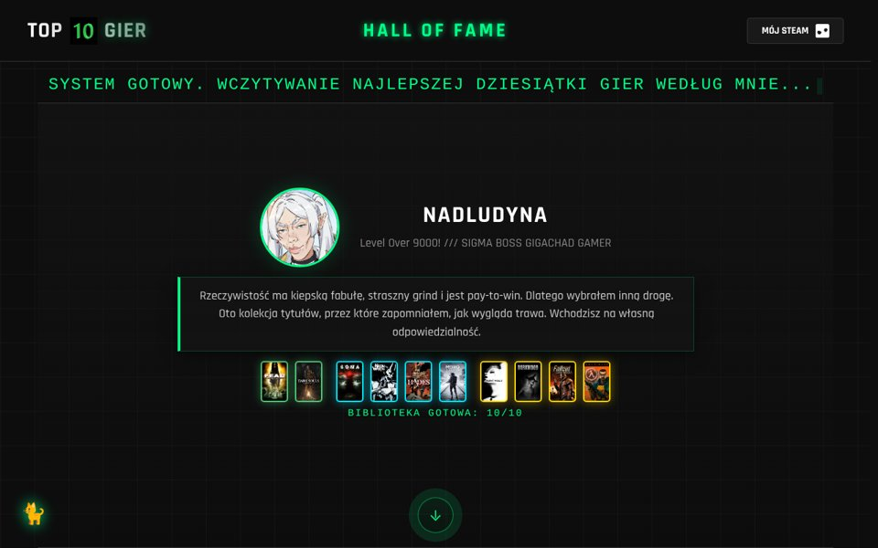

### Hey 

**Engineer, not a developer:** I figure out what's needed, use whatever gets results, and build the rest with AI. 
I pick things up fast — from zero to something useful in hours, not weeks. 
A vibe coder — with taste. Curious by default, AuDHD by design. 
**Currently going deeper into:** DevOps.

---

### ▸ Things I've built so far

 &nbsp;[**typeTrainer**](https://github.com/nadludyna/typeTrainer) — a typing trainer that finds your weak letters and builds the next words around them. Real words only. My engineering thesis. 
  

 &nbsp;[**ТЯГА**](https://github.com/nadludyna/tyaga) — paste a YouTube link, get a file. One small program with a browser UI, built on [yt-dlp](https://github.com/yt-dlp/yt-dlp), with releases for Windows, macOS and Linux. 
 

 &nbsp;[**TOP 10 GIER**](https://github.com/nadludyna/top10gier) — my personal hall of fame: ten favorite games, with tiers and very subjective reviews. A one-page site for a university web course. 
  

  
  
  

---

### ▸ Around the computer

 **Linux** — Distro-curious, practical first: a clean, focused system without noise or bloat. Home base is [CachyOS](https://cachyos.org) — built on [Arch](https://archlinux.org) — with KDE Plasma.

 **Windows** — Main system right now. Clean installs via [Rufus](https://rufus.ie) (it even grabs the official ISO) or [balenaEtcher](https://etcher.balena.io), then [WinUtil](https://github.com/ChrisTitusTech/winutil) for tweaks and [UniGetUI](https://devolutions.net/unigetui/) for updates. WSL and PowerShell day to day.

 **The pendulum** — Windows annoys me → I move to CachyOS for a while → Linux wears me out → back to Windows. Repeat. Both setups stay ready, so switching is cheap.

 **Self-hosting** — one project so far: a modded [Minecraft](https://www.minecraft.net) server on [Fabric](https://fabricmc.net), with scripts that check for mod updates.

 **Tinkering** — userscripts, Android app tweaks for my family (like [Morphe](https://morphe.software) patches for YouTube), and getting old games to run on modern PCs.

 **Modding** 
 ***Minecraft*** —  [Prism Launcher](https://prismlauncher.org) for minimal modpacks, the best way to juggle instances. 
 ***[Fallout: New Vegas](https://store.steampowered.com/app/22490/Fallout_New_Vegas/) / [TTW](https://taleoftwowastelands.com)*** — set up by following these guides: 
&nbsp;&nbsp;&nbsp;&nbsp; [Viva New Vegas](https://vivanewvegas.moddinglinked.com/intro.html) 
&nbsp;&nbsp;&nbsp;&nbsp; [Mojave Express](https://mojaveexpressguide.com/docs/Introduction) 
&nbsp;&nbsp;&nbsp;&nbsp; [Wasteland Survival Guide](https://wastelandsurvival.guide/docs/intro)

 **Open source** — not a rule, more of a pattern. I pick software that's popular for a reason, solid, and does its job — and more often than not, that turns out to be open source. Happy to pay for anything that earns it.

---

### ▸ How I approach problems

 **Define** — figure out what actually needs solving. 
 **Search** — check what already exists before reinventing the wheel. 
 **Use or build** — if a tool does the job, use it. If nothing fits, build a focused one.

**How I learn:** I keep the core in my head — the few load-bearing ideas every field stands on — and look up the rest when I need it. New things land on that frame fast: hours, not weeks.

  <code>practical &gt; complex</code> 
  <code>useful &gt; impressive</code> 
  <code>one precise move &gt; busywork</code> 
  <code>docs = part of the work</code>

---

### ▸ Working with AI

  
  
  

I've been using LLMs since GPT-3. Today, Claude is my main coding agent — and just as much a thinking partner.

`raw thought` → `talk it through` → `let it brew` → `.md in the vault` → `notes pile up` → `build`

**Thinking:** I say raw thoughts straight to Claude and talk them through. Then I let them brew — walk around, come back, finish the conversation. Whatever's worth keeping becomes a Markdown note in my Obsidian vault.

**Building:** once enough notes pile up and something clicks — *okay, this could be a thing* — I point Claude to that part of the vault and we build from my notes, not a blank prompt. Branches, PRs and tests before anything merges.

**Other models:** I've tried most mainstream and Chinese ones ([GLM 5.3](https://z.ai), [DeepSeek](https://www.deepseek.com) and [Kimi](https://www.kimi.com) were pleasant surprises), but Claude stays the strongest all-rounder for me. Gemini covers side chats and images; other models handle second opinions and code audits.

---

### ▸ Beyond tech

 **Languages** — Ukrainian · Russian · Polish · English · German *(basic)*

<b>The person behind the work</b> — games, typing, AuDHD, music, philosophy · click to expand

 

 **Gaming** — I play a lot of different things, but I keep coming back to the same few: 
`atmospheric worlds` `RPGs` `immersive sims` `horror` `weird indie` — plus a soft spot for puzzles and the occasional cozy game. The full library is on [Steam](https://steamcommunity.com/id/nadludyna/), my all-time top 10 is [here](https://nadludyna.github.io/top10gier/).

 **Typing** — regular practice on [Monkeytype](https://monkeytype.com/profile/nadludyna), tracking speed and accuracy. It's also my main way to switch my head off. I like mechanical keyboards. 
Current setup: <a href="https://www.monsgeek.com"><kbd>MonsGeek FUN60 Ultra</kbd></a> + <kbd>Astrolink switches</kbd>

 **Perspective** — I'm AuDHD: autistic and ADHD at once. I say it openly because it makes me easier to understand — for others and for myself. My brain often takes a non-standard route: that's where many of my ideas come from, and some of the friction.  
My head never really goes quiet, so I rest by doing: fast typing, music that keeps evolving, repeating voices until they sound just right (hence the easy impressions). I work with it, not against it — no romanticizing, no making it my whole identity. *[Amor fati](https://en.wikipedia.org/wiki/Amor_fati).*

 **Music** — a tuning knob for my nervous system: sometimes to balance a mood, sometimes to lean into it. These are just the highlights: my taste swings like a pendulum — something clicks, wears off, and later I come back and hear it anew. Some of it I know inside out, some I just heard a few times and it stuck.

 <b>Atmosphere</b> — ambient · drone · dark ambient · hauntology · vaporwave · barber beats

 
&nbsp;&nbsp;&nbsp;&nbsp;&nbsp;&nbsp;▸ <a href="https://music.youtube.com/search?q=Eternal+Depths">Eternal Depths</a> 
&nbsp;&nbsp;&nbsp;&nbsp;&nbsp;&nbsp;▸ <a href="https://music.youtube.com/search?q=Warmth">Warmth</a> 
&nbsp;&nbsp;&nbsp;&nbsp;&nbsp;&nbsp;▸ <a href="https://music.youtube.com/search?q=Alphaxone">Alphaxone</a> 
&nbsp;&nbsp;&nbsp;&nbsp;&nbsp;&nbsp;▸ <a href="https://music.youtube.com/search?q=Atrium+Carceri">Atrium Carceri</a> 
&nbsp;&nbsp;&nbsp;&nbsp;&nbsp;&nbsp;▸ <a href="https://music.youtube.com/search?q=The+Caretaker">The Caretaker</a> 
&nbsp;&nbsp;&nbsp;&nbsp;&nbsp;&nbsp;▸ <a href="https://music.youtube.com/search?q=Windows96">Windows96</a> 
&nbsp;&nbsp;&nbsp;&nbsp;&nbsp;&nbsp;▸ <a href="https://music.youtube.com/search?q=Mabisyo">Mabisyo</a> 
&nbsp;&nbsp;&nbsp;&nbsp;&nbsp;&nbsp;▸ <a href="https://music.youtube.com/search?q=haircuts+for+men">haircuts for men</a> 
&nbsp;&nbsp;&nbsp;&nbsp;&nbsp;&nbsp;▸ <a href="https://music.youtube.com/search?q=C418">C418</a> 
&nbsp;&nbsp;&nbsp;&nbsp;&nbsp;&nbsp;▸ <a href="https://music.youtube.com/search?q=Kane+Parsons">Kane Parsons</a> 
&nbsp;&nbsp;&nbsp;&nbsp;&nbsp;&nbsp;▸ <a href="https://music.youtube.com/playlist?list=OLAK5uy_mutZ0A5Ekpmw-PcwIwOKs0kldJ6Y2myVw">Boards of Canada</a> 
&nbsp;&nbsp;&nbsp;&nbsp;&nbsp;&nbsp;▸ <a href="https://music.youtube.com/search?q=Jerry+Martin+The+Sims+build+mode">The Sims muzak</a> 
&nbsp;&nbsp;&nbsp;&nbsp;&nbsp;&nbsp;▸ <a href="https://music.youtube.com/search?q=William+Basinski+The+Disintegration+Loops">William Basinski — The Disintegration Loops</a>
  

 <b>Electronic</b> — IDM · synthwave · art pop

 
&nbsp;&nbsp;&nbsp;&nbsp;&nbsp;&nbsp;▸ <a href="https://music.youtube.com/search?q=Aphex+Twin">Aphex Twin</a> 
&nbsp;&nbsp;&nbsp;&nbsp;&nbsp;&nbsp;▸ <a href="https://music.youtube.com/search?q=Orbital">Orbital</a> 
&nbsp;&nbsp;&nbsp;&nbsp;&nbsp;&nbsp;▸ <a href="https://music.youtube.com/search?q=Kraftwerk">Kraftwerk</a> 
&nbsp;&nbsp;&nbsp;&nbsp;&nbsp;&nbsp;▸ <a href="https://music.youtube.com/search?q=SOPHIE">SOPHIE</a> 
&nbsp;&nbsp;&nbsp;&nbsp;&nbsp;&nbsp;▸ <a href="https://music.youtube.com/search?q=Bj%C3%B6rk">Björk</a> 
&nbsp;&nbsp;&nbsp;&nbsp;&nbsp;&nbsp;▸ <a href="https://music.youtube.com/search?q=Vangelis+Blade+Runner">Vangelis — Blade Runner & 2049</a> 
&nbsp;&nbsp;&nbsp;&nbsp;&nbsp;&nbsp;▸ <a href="https://music.youtube.com/search?q=Arca">Arca</a> 
&nbsp;&nbsp;&nbsp;&nbsp;&nbsp;&nbsp;▸ <a href="https://music.youtube.com/search?q=Disasterpeace">Disasterpeace</a> 
&nbsp;&nbsp;&nbsp;&nbsp;&nbsp;&nbsp;▸ <a href="https://music.youtube.com/search?q=Susumu+Hirasawa">Susumu Hirasawa</a> 
&nbsp;&nbsp;&nbsp;&nbsp;&nbsp;&nbsp;▸ <a href="https://music.youtube.com/search?q=Lorn">Lorn</a> 
&nbsp;&nbsp;&nbsp;&nbsp;&nbsp;&nbsp;▸ <a href="https://music.youtube.com/search?q=Perturbator">Perturbator</a> 
&nbsp;&nbsp;&nbsp;&nbsp;&nbsp;&nbsp;▸ <a href="https://music.youtube.com/search?q=Lazerhawk">Lazerhawk</a> 
&nbsp;&nbsp;&nbsp;&nbsp;&nbsp;&nbsp;▸ <a href="https://music.youtube.com/search?q=Scattle">Scattle</a> 
&nbsp;&nbsp;&nbsp;&nbsp;&nbsp;&nbsp;▸ <a href="https://music.youtube.com/search?q=Graham+Kartna">Graham Kartna</a> 
&nbsp;&nbsp;&nbsp;&nbsp;&nbsp;&nbsp;▸ <a href="https://music.youtube.com/search?q=metaroom">metaroom</a> 
&nbsp;&nbsp;&nbsp;&nbsp;&nbsp;&nbsp;▸ <a href="https://music.youtube.com/search?q=Cynthoni">Cynthoni</a>
  

 <b>Caretaker fan universe</b> — hauntology · plunderphonics

 
&nbsp;&nbsp;&nbsp;&nbsp;&nbsp;&nbsp;▸ <a href="https://music.youtube.com/search?q=The+Caretakers+Nowhere+at+the+Millennium+of+Space+Redux">Nowhere at the Millennium of Space: Redux</a> 
&nbsp;&nbsp;&nbsp;&nbsp;&nbsp;&nbsp;▸ <a href="https://music.youtube.com/search?q=Light+and+Darkness+Context+Switch">Light and Darkness</a> 
&nbsp;&nbsp;&nbsp;&nbsp;&nbsp;&nbsp;▸ <a href="https://music.youtube.com/search?q=We+Are+Eternal">We Are Eternal</a> 
&nbsp;&nbsp;&nbsp;&nbsp;&nbsp;&nbsp;▸ <a href="https://music.youtube.com/search?q=Tome+of+Patina+and+Self-recursion">Tome of Patina and Self-recursion</a> 
&nbsp;&nbsp;&nbsp;&nbsp;&nbsp;&nbsp;▸ <a href="https://music.youtube.com/search?q=Milwaukee+Protocol+Caretaker">Milwaukee Protocol</a> 
&nbsp;&nbsp;&nbsp;&nbsp;&nbsp;&nbsp;▸ <a href="https://music.youtube.com/search?q=The+Patients+vCJD">vCJD</a>
  

 <b>Rock &amp; metal</b> — prog · shoegaze · post-rock · post-punk

 
&nbsp;&nbsp;&nbsp;&nbsp;&nbsp;&nbsp;▸ <a href="https://music.youtube.com/search?q=Radiohead">Radiohead</a> 
&nbsp;&nbsp;&nbsp;&nbsp;&nbsp;&nbsp;▸ <a href="https://music.youtube.com/search?q=Muse">Muse</a> 
&nbsp;&nbsp;&nbsp;&nbsp;&nbsp;&nbsp;▸ <a href="https://music.youtube.com/search?q=Slowdive">Slowdive</a> 
&nbsp;&nbsp;&nbsp;&nbsp;&nbsp;&nbsp;▸ <a href="https://music.youtube.com/search?q=Talk+Talk">Talk Talk</a> 
&nbsp;&nbsp;&nbsp;&nbsp;&nbsp;&nbsp;▸ <a href="https://music.youtube.com/search?q=Porcupine+Tree">Porcupine Tree</a> 
&nbsp;&nbsp;&nbsp;&nbsp;&nbsp;&nbsp;▸ <a href="https://music.youtube.com/search?q=Yes">Yes</a> 
&nbsp;&nbsp;&nbsp;&nbsp;&nbsp;&nbsp;▸ <a href="https://music.youtube.com/search?q=Pink+Floyd">Pink Floyd</a> 
&nbsp;&nbsp;&nbsp;&nbsp;&nbsp;&nbsp;▸ <a href="https://music.youtube.com/search?q=Tool">Tool</a> 
&nbsp;&nbsp;&nbsp;&nbsp;&nbsp;&nbsp;▸ <a href="https://music.youtube.com/search?q=Kayo+Dot">Kayo Dot</a> 
&nbsp;&nbsp;&nbsp;&nbsp;&nbsp;&nbsp;▸ <a href="https://music.youtube.com/search?q=maudlin+of+the+Well">maudlin of the Well</a> 
&nbsp;&nbsp;&nbsp;&nbsp;&nbsp;&nbsp;▸ <a href="https://music.youtube.com/@RomanSecetra">Devin Townsend Project</a> 
&nbsp;&nbsp;&nbsp;&nbsp;&nbsp;&nbsp;▸ <a href="https://music.youtube.com/search?q=pilotredsun">pilotredsun</a> 
&nbsp;&nbsp;&nbsp;&nbsp;&nbsp;&nbsp;▸ <a href="https://music.youtube.com/search?q=Gorillaz">Gorillaz</a> 
&nbsp;&nbsp;&nbsp;&nbsp;&nbsp;&nbsp;▸ <a href="https://music.youtube.com/search?q=Tame+Impala">Tame Impala</a> 
&nbsp;&nbsp;&nbsp;&nbsp;&nbsp;&nbsp;▸ <a href="https://music.youtube.com/search?q=Red+Vox">Red Vox</a> 
&nbsp;&nbsp;&nbsp;&nbsp;&nbsp;&nbsp;▸ <a href="https://music.youtube.com/search?q=Molchat+Doma">Molchat Doma</a> 
&nbsp;&nbsp;&nbsp;&nbsp;&nbsp;&nbsp;▸ <a href="https://music.youtube.com/search?q=%D0%9A%D0%B8%D0%BD%D0%BE">Кино</a> 
&nbsp;&nbsp;&nbsp;&nbsp;&nbsp;&nbsp;▸ <a href="https://music.youtube.com/search?q=King+Crimson">King Crimson</a> 
&nbsp;&nbsp;&nbsp;&nbsp;&nbsp;&nbsp;▸ <a href="https://music.youtube.com/search?q=The+Mars+Volta">The Mars Volta</a> 
&nbsp;&nbsp;&nbsp;&nbsp;&nbsp;&nbsp;▸ <a href="https://music.youtube.com/search?q=Godspeed+You%21+Black+Emperor">Godspeed You! Black Emperor</a> 
&nbsp;&nbsp;&nbsp;&nbsp;&nbsp;&nbsp;▸ <a href="https://music.youtube.com/search?q=Queen">Queen</a> 
&nbsp;&nbsp;&nbsp;&nbsp;&nbsp;&nbsp;▸ <a href="https://music.youtube.com/search?q=Nine+Inch+Nails">Nine Inch Nails</a> 
&nbsp;&nbsp;&nbsp;&nbsp;&nbsp;&nbsp;▸ <a href="https://music.youtube.com/search?q=Monobody">Monobody</a> 
&nbsp;&nbsp;&nbsp;&nbsp;&nbsp;&nbsp;▸ <a href="https://music.youtube.com/search?q=Alice+in+Chains+Them+Bones">Alice in Chains — Them Bones</a> 
&nbsp;&nbsp;&nbsp;&nbsp;&nbsp;&nbsp;▸ <a href="https://music.youtube.com/search?q=Metallica+Enter+Sandman">Metallica — Enter Sandman</a> 
&nbsp;&nbsp;&nbsp;&nbsp;&nbsp;&nbsp;▸ <a href="https://www.youtube.com/watch?v=HpQbVqGmGSA">Klaus Johann Grobe</a>
  

 <b>Classical</b> — piano, symphonies, opera, organ

 
&nbsp;&nbsp;&nbsp;&nbsp;&nbsp;&nbsp;▸ <a href="https://www.youtube.com/@HALIDONMUSIC/search?query=Bach">Bach</a> 
&nbsp;&nbsp;&nbsp;&nbsp;&nbsp;&nbsp;▸ <a href="https://www.youtube.com/@HALIDONMUSIC/search?query=Chopin">Chopin</a> 
&nbsp;&nbsp;&nbsp;&nbsp;&nbsp;&nbsp;▸ <a href="https://www.youtube.com/@HALIDONMUSIC/search?query=Liszt">Liszt</a> 
&nbsp;&nbsp;&nbsp;&nbsp;&nbsp;&nbsp;▸ <a href="https://www.youtube.com/@HALIDONMUSIC/search?query=Tchaikovsky">Tchaikovsky</a> 
&nbsp;&nbsp;&nbsp;&nbsp;&nbsp;&nbsp;▸ <a href="https://www.youtube.com/@HALIDONMUSIC/search?query=Wagner">Wagner</a> 
&nbsp;&nbsp;&nbsp;&nbsp;&nbsp;&nbsp;▸ <a href="https://www.youtube.com/@HALIDONMUSIC/search?query=Rachmaninoff">Rachmaninoff</a> 
&nbsp;&nbsp;&nbsp;&nbsp;&nbsp;&nbsp;▸ <a href="https://www.youtube.com/@HALIDONMUSIC/search?query=Shostakovich">Shostakovich</a> 
&nbsp;&nbsp;&nbsp;&nbsp;&nbsp;&nbsp;▸ <a href="https://www.youtube.com/@EssentialClassics">more on Essential Classics</a>
  

 <b>Pop</b> — dance-pop · synth-pop · alt-pop

 
&nbsp;&nbsp;&nbsp;&nbsp;&nbsp;&nbsp;▸ <a href="https://music.youtube.com/search?q=Michael+Jackson">Michael Jackson</a> 
&nbsp;&nbsp;&nbsp;&nbsp;&nbsp;&nbsp;▸ <a href="https://music.youtube.com/search?q=Modern+Talking">Modern Talking</a> 
&nbsp;&nbsp;&nbsp;&nbsp;&nbsp;&nbsp;▸ <a href="https://music.youtube.com/search?q=Dua+Lipa">Dua Lipa</a> 
&nbsp;&nbsp;&nbsp;&nbsp;&nbsp;&nbsp;▸ <a href="https://music.youtube.com/search?q=Doja+Cat">Doja Cat</a> 
&nbsp;&nbsp;&nbsp;&nbsp;&nbsp;&nbsp;▸ <a href="https://music.youtube.com/search?q=Sabrina+Carpenter">Sabrina Carpenter</a> 
&nbsp;&nbsp;&nbsp;&nbsp;&nbsp;&nbsp;▸ <a href="https://music.youtube.com/search?q=Charli+XCX">Charli XCX</a> 
&nbsp;&nbsp;&nbsp;&nbsp;&nbsp;&nbsp;▸ <a href="https://music.youtube.com/search?q=PinkPantheress">PinkPantheress</a> 
&nbsp;&nbsp;&nbsp;&nbsp;&nbsp;&nbsp;▸ <a href="https://music.youtube.com/search?q=Ice+Spice">Ice Spice</a> 
&nbsp;&nbsp;&nbsp;&nbsp;&nbsp;&nbsp;▸ <a href="https://music.youtube.com/search?q=Studio+Killers">Studio Killers</a> 
&nbsp;&nbsp;&nbsp;&nbsp;&nbsp;&nbsp;▸ <a href="https://music.youtube.com/search?q=Magdalena+Bay">Magdalena Bay</a> 
&nbsp;&nbsp;&nbsp;&nbsp;&nbsp;&nbsp;▸ <a href="https://music.youtube.com/search?q=Shygirl">Shygirl</a> 
&nbsp;&nbsp;&nbsp;&nbsp;&nbsp;&nbsp;▸ <a href="https://music.youtube.com/search?q=ADELA">ADELA</a> 
&nbsp;&nbsp;&nbsp;&nbsp;&nbsp;&nbsp;▸ <a href="https://music.youtube.com/search?q=Billie+Eilish">Billie Eilish</a> 
&nbsp;&nbsp;&nbsp;&nbsp;&nbsp;&nbsp;▸ <a href="https://music.youtube.com/search?q=Caroline+Polachek">Caroline Polachek</a> 
&nbsp;&nbsp;&nbsp;&nbsp;&nbsp;&nbsp;▸ <a href="https://music.youtube.com/search?q=Dev+Lemons">Dev Lemons</a>
  

 <b>Golden oldies</b> — rock &#39;n&#39; roll · crooners · western

 
&nbsp;&nbsp;&nbsp;&nbsp;&nbsp;&nbsp;▸ <a href="https://music.youtube.com/search?q=Elvis+Presley">Elvis Presley</a> 
&nbsp;&nbsp;&nbsp;&nbsp;&nbsp;&nbsp;▸ <a href="https://music.youtube.com/search?q=Frank+Sinatra">Frank Sinatra</a> 
&nbsp;&nbsp;&nbsp;&nbsp;&nbsp;&nbsp;▸ <a href="https://music.youtube.com/search?q=Marty+Robbins">Marty Robbins</a> 
&nbsp;&nbsp;&nbsp;&nbsp;&nbsp;&nbsp;▸ <a href="https://music.youtube.com/channel/UC_X19d3yM9Nq1_4QSFP3EVQ">Jerry Burnham</a> &amp; <a href="https://music.youtube.com/channel/UCuC44ynuN075dUfz3TTLbvw">Don Burnham</a>
  

 <b>Loud &amp; chaotic</b> — breakcore · digital hardcore · rage · trap · hyperpop

 
&nbsp;&nbsp;&nbsp;&nbsp;&nbsp;&nbsp;▸ <a href="https://music.youtube.com/search?q=bye2">bye2</a> 
&nbsp;&nbsp;&nbsp;&nbsp;&nbsp;&nbsp;▸ <a href="https://music.youtube.com/search?q=Machine+Girl">Machine Girl</a> 
&nbsp;&nbsp;&nbsp;&nbsp;&nbsp;&nbsp;▸ <a href="https://music.youtube.com/search?q=Goreshit">Goreshit</a> 
&nbsp;&nbsp;&nbsp;&nbsp;&nbsp;&nbsp;▸ <a href="https://music.youtube.com/search?q=Sewerslut">Sewerslut</a> 
&nbsp;&nbsp;&nbsp;&nbsp;&nbsp;&nbsp;▸ <a href="https://music.youtube.com/search?q=vertigoaway">vertigoaway</a> 
&nbsp;&nbsp;&nbsp;&nbsp;&nbsp;&nbsp;▸ <a href="https://music.youtube.com/search?q=strxwberrymilk">strxwberrymilk</a> 
&nbsp;&nbsp;&nbsp;&nbsp;&nbsp;&nbsp;▸ <a href="https://music.youtube.com/search?q=Yameii+Online">Yameii Online</a> 
&nbsp;&nbsp;&nbsp;&nbsp;&nbsp;&nbsp;▸ <a href="https://music.youtube.com/search?q=Odetari">Odetari</a> 
&nbsp;&nbsp;&nbsp;&nbsp;&nbsp;&nbsp;▸ <a href="https://music.youtube.com/search?q=Ghostemane">Ghostemane</a> 
&nbsp;&nbsp;&nbsp;&nbsp;&nbsp;&nbsp;▸ <a href="https://music.youtube.com/search?q=Scarlxrd">Scarlxrd</a> 
&nbsp;&nbsp;&nbsp;&nbsp;&nbsp;&nbsp;▸ <a href="https://music.youtube.com/search?q=Tyler%2C+The+Creator">Tyler, The Creator</a> 
&nbsp;&nbsp;&nbsp;&nbsp;&nbsp;&nbsp;▸ <a href="https://music.youtube.com/search?q=Travis+Scott">Travis Scott</a> 
&nbsp;&nbsp;&nbsp;&nbsp;&nbsp;&nbsp;▸ <a href="https://music.youtube.com/search?q=Playboi+Carti">Playboi Carti</a> 
&nbsp;&nbsp;&nbsp;&nbsp;&nbsp;&nbsp;▸ <a href="https://music.youtube.com/search?q=Yeat">Yeat</a> 
&nbsp;&nbsp;&nbsp;&nbsp;&nbsp;&nbsp;▸ <a href="https://music.youtube.com/search?q=Ken+Carson">Ken Carson</a> 
&nbsp;&nbsp;&nbsp;&nbsp;&nbsp;&nbsp;▸ <a href="https://music.youtube.com/search?q=Don+Toliver">Don Toliver</a> 
&nbsp;&nbsp;&nbsp;&nbsp;&nbsp;&nbsp;▸ <a href="https://music.youtube.com/search?q=2hollis">2hollis</a> 
&nbsp;&nbsp;&nbsp;&nbsp;&nbsp;&nbsp;▸ <a href="https://music.youtube.com/search?q=DrainWh0re">DrainWh0re</a>
  

 <b>Eastern European scene</b> — rap · hyperpop · cult classics

 
&nbsp;&nbsp;&nbsp;&nbsp;&nbsp;&nbsp;▸ <a href="https://music.youtube.com/search?q=%D0%9C%D0%B0%D0%BB%D0%B5%D0%BD%D1%8C%D0%BA%D0%B8%D0%B9+%D0%AF%D1%80%D1%87%D0%B5">Маленький Ярче</a> 
&nbsp;&nbsp;&nbsp;&nbsp;&nbsp;&nbsp;▸ <a href="https://music.youtube.com/search?q=Fendiglock">Fendiglock</a> 
&nbsp;&nbsp;&nbsp;&nbsp;&nbsp;&nbsp;▸ <a href="https://music.youtube.com/search?q=Kai+Angel">Kai Angel</a> 
&nbsp;&nbsp;&nbsp;&nbsp;&nbsp;&nbsp;▸ <a href="https://music.youtube.com/search?q=Zavet">Zavet</a> 
&nbsp;&nbsp;&nbsp;&nbsp;&nbsp;&nbsp;▸ <a href="https://genius.com/albums/Shtrihcod/5331">Штрихкод</a> 
&nbsp;&nbsp;&nbsp;&nbsp;&nbsp;&nbsp;▸ <a href="https://music.youtube.com/search?q=OBLADAET">OBLADAET</a> 
&nbsp;&nbsp;&nbsp;&nbsp;&nbsp;&nbsp;▸ <a href="https://music.youtube.com/search?q=PLOHOYPAREN">PLOHOYPAREN</a> 
&nbsp;&nbsp;&nbsp;&nbsp;&nbsp;&nbsp;▸ <a href="https://music.youtube.com/search?q=Bumble+Beezy">Bumble Beezy</a> 
&nbsp;&nbsp;&nbsp;&nbsp;&nbsp;&nbsp;▸ <a href="https://music.youtube.com/search?q=1.Kla%24">1.Kla$</a> 
&nbsp;&nbsp;&nbsp;&nbsp;&nbsp;&nbsp;▸ <a href="https://music.youtube.com/search?q=Gavrilina">Gavrilina</a> 
&nbsp;&nbsp;&nbsp;&nbsp;&nbsp;&nbsp;▸ <a href="https://music.youtube.com/search?q=Boulevard+Depo">Boulevard Depo</a> 
&nbsp;&nbsp;&nbsp;&nbsp;&nbsp;&nbsp;▸ <a href="https://music.youtube.com/search?q=Lil+Krystalll">Lil Krystalll</a> 
&nbsp;&nbsp;&nbsp;&nbsp;&nbsp;&nbsp;▸ <a href="https://music.youtube.com/search?q=Soda+Luv">Soda Luv</a> 
&nbsp;&nbsp;&nbsp;&nbsp;&nbsp;&nbsp;▸ <a href="https://music.youtube.com/search?q=Jeembo">Jeembo</a> 
&nbsp;&nbsp;&nbsp;&nbsp;&nbsp;&nbsp;▸ <a href="https://music.youtube.com/search?q=BATO">BATO</a> 
&nbsp;&nbsp;&nbsp;&nbsp;&nbsp;&nbsp;▸ <a href="https://music.youtube.com/search?q=Tveth">Tveth</a> 
&nbsp;&nbsp;&nbsp;&nbsp;&nbsp;&nbsp;▸ <a href="https://music.youtube.com/search?q=%D0%A1%D0%B8%D0%B4%D0%BE%D0%B4%D0%B6%D0%B8+%D0%94%D1%83%D0%B1%D0%BEshit">Сидоджи Дубоshit</a> 
&nbsp;&nbsp;&nbsp;&nbsp;&nbsp;&nbsp;▸ <a href="https://music.youtube.com/search?q=Lovv66">Lovv66</a> 
&nbsp;&nbsp;&nbsp;&nbsp;&nbsp;&nbsp;▸ <a href="https://music.youtube.com/playlist?list=OLAK5uy_l0C49wP3UfzzhA8C2qPDPdS1w9VLpXHXo">Скриптонит</a> 
&nbsp;&nbsp;&nbsp;&nbsp;&nbsp;&nbsp;▸ <a href="https://music.youtube.com/search?q=pyrokinesis">pyrokinesis</a> 
&nbsp;&nbsp;&nbsp;&nbsp;&nbsp;&nbsp;▸ <a href="https://music.youtube.com/search?q=%D0%98%D0%BD%D1%81%D1%82%D0%B0%D1%81%D0%B0%D0%BC%D0%BA%D0%B0">Инстасамка</a> 
&nbsp;&nbsp;&nbsp;&nbsp;&nbsp;&nbsp;▸ <a href="https://music.youtube.com/search?q=%D0%A1%D0%BA%D1%80%D1%8F%D0%B1%D0%B8%D0%BD">Скрябин</a> 
&nbsp;&nbsp;&nbsp;&nbsp;&nbsp;&nbsp;▸ <a href="https://music.youtube.com/search?q=%D0%9C%D0%B5%D0%B9%D0%B1%D0%B8+%D0%91%D0%B5%D0%B9%D0%B1%D0%B8">Мейби Бейби</a> 
&nbsp;&nbsp;&nbsp;&nbsp;&nbsp;&nbsp;▸ <a href="https://music.youtube.com/search?q=%D0%9C%D0%B8%D1%85%D0%B0%D0%B8%D0%BB+%D0%9A%D1%80%D1%83%D0%B3">Михаил Круг</a> 
&nbsp;&nbsp;&nbsp;&nbsp;&nbsp;&nbsp;▸ <a href="https://music.youtube.com/search?q=%D0%A8%D0%BE%D1%80%D1%82%D0%BF%D0%B0%D1%80%D0%B8%D1%81">Шортпарис</a> 
&nbsp;&nbsp;&nbsp;&nbsp;&nbsp;&nbsp;▸ <a href="https://music.youtube.com/search?q=IC3PEAK">IC3PEAK</a> 
&nbsp;&nbsp;&nbsp;&nbsp;&nbsp;&nbsp;▸ Klavdia Petrivna: <a href="https://www.youtube.com/watch?v=nApYUBVaJYY">one</a> · <a href="https://www.youtube.com/watch?v=sY-zOE6q83c">two</a> 
&nbsp;&nbsp;&nbsp;&nbsp;&nbsp;&nbsp;▸ <a href="https://music.youtube.com/search?q=Dekma">Dekma</a> 
&nbsp;&nbsp;&nbsp;&nbsp;&nbsp;&nbsp;▸ <a href="https://music.youtube.com/search?q=DMT+Boy">DMT Boy</a>
  

 <b>Game soundtracks</b> — the highlights

 
&nbsp;&nbsp;&nbsp;&nbsp;&nbsp;&nbsp;▸ <a href="https://music.youtube.com/search?q=Half-Life+soundtrack">Half-Life 1 & 2</a> 
&nbsp;&nbsp;&nbsp;&nbsp;&nbsp;&nbsp;▸ <a href="https://music.youtube.com/search?q=STALKER+soundtrack">S.T.A.L.K.E.R.</a> 
&nbsp;&nbsp;&nbsp;&nbsp;&nbsp;&nbsp;▸ <a href="https://music.youtube.com/search?q=Fallout+soundtrack+Mark+Morgan">Fallout 1, 2 & New Vegas</a> 
&nbsp;&nbsp;&nbsp;&nbsp;&nbsp;&nbsp;▸ <a href="https://music.youtube.com/search?q=Deus+Ex+soundtrack">Deus Ex</a> 
&nbsp;&nbsp;&nbsp;&nbsp;&nbsp;&nbsp;▸ <a href="https://music.youtube.com/search?q=System+Shock+2+soundtrack">System Shock 2</a> 
&nbsp;&nbsp;&nbsp;&nbsp;&nbsp;&nbsp;▸ <a href="https://music.youtube.com/search?q=Quake+soundtrack">Quake</a> 
&nbsp;&nbsp;&nbsp;&nbsp;&nbsp;&nbsp;▸ <a href="https://www.youtube.com/playlist?list=PLn4oIa4_kWRqaLK6eTHdKqYqcpA9_-thv">Silent Hill 1–4</a> 
&nbsp;&nbsp;&nbsp;&nbsp;&nbsp;&nbsp;▸ <a href="https://music.youtube.com/search?q=Dark+Souls+soundtrack">Dark Souls 1 & 3</a> 
&nbsp;&nbsp;&nbsp;&nbsp;&nbsp;&nbsp;▸ <a href="https://music.youtube.com/search?q=FEAR+soundtrack">F.E.A.R.</a> 
&nbsp;&nbsp;&nbsp;&nbsp;&nbsp;&nbsp;▸ <a href="https://music.youtube.com/search?q=DOOM+Mick+Gordon+soundtrack">DOOM 2016 & Eternal</a> 
&nbsp;&nbsp;&nbsp;&nbsp;&nbsp;&nbsp;▸ <a href="https://music.youtube.com/search?q=ULTRAKILL+soundtrack">ULTRAKILL</a> 
&nbsp;&nbsp;&nbsp;&nbsp;&nbsp;&nbsp;▸ <a href="https://music.youtube.com/search?q=Hotline+Miami+soundtrack">Hotline Miami 1 & 2</a> 
&nbsp;&nbsp;&nbsp;&nbsp;&nbsp;&nbsp;▸ <a href="https://music.youtube.com/search?q=Postal+soundtrack">Postal</a> 
&nbsp;&nbsp;&nbsp;&nbsp;&nbsp;&nbsp;▸ <a href="https://music.youtube.com/search?q=Darkwood+soundtrack">Darkwood</a> 
&nbsp;&nbsp;&nbsp;&nbsp;&nbsp;&nbsp;▸ <a href="https://music.youtube.com/search?q=Signalis+soundtrack">Signalis</a> 
&nbsp;&nbsp;&nbsp;&nbsp;&nbsp;&nbsp;▸ <a href="https://music.youtube.com/search?q=Psychopomp+game+soundtrack">Psychopomp</a> 
&nbsp;&nbsp;&nbsp;&nbsp;&nbsp;&nbsp;▸ <a href="https://xix01.bandcamp.com/">Buckshot Roulette + XIX</a> 
&nbsp;&nbsp;&nbsp;&nbsp;&nbsp;&nbsp;▸ <a href="https://music.youtube.com/search?q=Five+Nights+at+Freddy%27s+soundtrack">FNAF: ambiences & jingles</a> 
&nbsp;&nbsp;&nbsp;&nbsp;&nbsp;&nbsp;▸ <a href="https://music.youtube.com/search?q=Yume+Nikki+soundtrack">Yume Nikki</a> 
&nbsp;&nbsp;&nbsp;&nbsp;&nbsp;&nbsp;▸ <a href="https://music.youtube.com/search?q=Hypnagogia+soundtrack">Hypnagogia 1 & 2</a> 
&nbsp;&nbsp;&nbsp;&nbsp;&nbsp;&nbsp;▸ <a href="https://music.youtube.com/search?q=Disillusion+soundtrack">Disillusion</a> 
&nbsp;&nbsp;&nbsp;&nbsp;&nbsp;&nbsp;▸ <a href="https://music.youtube.com/search?q=ENA+Dream+BBQ+soundtrack">ENA & Dream BBQ</a> 
&nbsp;&nbsp;&nbsp;&nbsp;&nbsp;&nbsp;▸ <a href="https://music.youtube.com/search?q=NieR+Automata+soundtrack">NieR: Automata</a> 
&nbsp;&nbsp;&nbsp;&nbsp;&nbsp;&nbsp;▸ <a href="https://music.youtube.com/search?q=Hades+soundtrack+Darren+Korb">Hades</a> 
&nbsp;&nbsp;&nbsp;&nbsp;&nbsp;&nbsp;▸ <a href="https://music.youtube.com/search?q=Neon+White+soundtrack+Machine+Girl">Neon White</a> 
&nbsp;&nbsp;&nbsp;&nbsp;&nbsp;&nbsp;▸ <a href="https://music.youtube.com/search?q=Noita+soundtrack">Noita</a> 
&nbsp;&nbsp;&nbsp;&nbsp;&nbsp;&nbsp;▸ <a href="https://music.youtube.com/search?q=Against+the+Storm+soundtrack">Against the Storm</a> 
&nbsp;&nbsp;&nbsp;&nbsp;&nbsp;&nbsp;▸ <a href="https://music.youtube.com/search?q=Core+Keeper+soundtrack">Core Keeper</a> 
&nbsp;&nbsp;&nbsp;&nbsp;&nbsp;&nbsp;▸ <a href="https://music.youtube.com/search?q=Vintage+Story+soundtrack">Vintage Story</a> 
&nbsp;&nbsp;&nbsp;&nbsp;&nbsp;&nbsp;▸ <a href="https://music.youtube.com/search?q=Terraria+soundtrack">Terraria</a> 
&nbsp;&nbsp;&nbsp;&nbsp;&nbsp;&nbsp;▸ <a href="https://music.youtube.com/search?q=Ori+soundtrack+Gareth+Coker">Ori 1 & 2</a> 
&nbsp;&nbsp;&nbsp;&nbsp;&nbsp;&nbsp;▸ <a href="https://music.youtube.com/search?q=Limbo+soundtrack">Limbo</a> 
&nbsp;&nbsp;&nbsp;&nbsp;&nbsp;&nbsp;▸ <a href="https://music.youtube.com/search?q=Baba+Is+You+soundtrack">Baba Is You</a> 
&nbsp;&nbsp;&nbsp;&nbsp;&nbsp;&nbsp;▸ <a href="https://music.youtube.com/search?q=Amanita+Design+Machinarium+Samorost+soundtrack">Machinarium & Samorost</a> 
&nbsp;&nbsp;&nbsp;&nbsp;&nbsp;&nbsp;▸ <a href="https://music.youtube.com/search?q=Critters+for+Sale+soundtrack">Critters for Sale</a> 
&nbsp;&nbsp;&nbsp;&nbsp;&nbsp;&nbsp;▸ <a href="https://music.youtube.com/playlist?list=OLAK5uy_mr278vVdfMs0V6rtNg7iwYfkQ4dTzc4bU">Easy Delivery Co.</a> 
&nbsp;&nbsp;&nbsp;&nbsp;&nbsp;&nbsp;▸ <a href="https://music.youtube.com/search?q=My+Summer+Car+techno">My Summer Car techno</a> 
&nbsp;&nbsp;&nbsp;&nbsp;&nbsp;&nbsp;▸ <a href="https://music.youtube.com/search?q=GTA+radio">GTA radio</a> 
&nbsp;&nbsp;&nbsp;&nbsp;&nbsp;&nbsp;▸ <a href="https://music.youtube.com/search?q=Supercell+soundtrack+Clash+of+Clans+Brawl+Stars">Supercell games</a> 
&nbsp;&nbsp;&nbsp;&nbsp;&nbsp;&nbsp;▸ <a href="https://music.youtube.com/search?q=Plants+vs+Zombies+soundtrack">Plants vs. Zombies</a> 
&nbsp;&nbsp;&nbsp;&nbsp;&nbsp;&nbsp;▸ <a href="https://music.youtube.com/search?q=Balatro+soundtrack">Balatro</a> 
&nbsp;&nbsp;&nbsp;&nbsp;&nbsp;&nbsp;▸ <a href="https://music.youtube.com/search?q=Toby+Fox+Undertale+Deltarune+soundtrack">Undertale & Deltarune</a> 
&nbsp;&nbsp;&nbsp;&nbsp;&nbsp;&nbsp;▸ <a href="https://music.youtube.com/search?q=OneShot+soundtrack">OneShot</a> 
&nbsp;&nbsp;&nbsp;&nbsp;&nbsp;&nbsp;▸ <a href="https://music.youtube.com/search?q=Hyper+Light+Drifter+soundtrack+Disasterpeace">Hyper Light Drifter</a> 
&nbsp;&nbsp;&nbsp;&nbsp;&nbsp;&nbsp;▸ <a href="https://music.youtube.com/search?q=Katana+Zero+soundtrack">Katana Zero</a> 
&nbsp;&nbsp;&nbsp;&nbsp;&nbsp;&nbsp;▸ <a href="https://music.youtube.com/search?q=Cult+of+the+Lamb+soundtrack">Cult of the Lamb</a> 
&nbsp;&nbsp;&nbsp;&nbsp;&nbsp;&nbsp;▸ <a href="https://music.youtube.com/search?q=Echo+Point+Nova+soundtrack">Echo Point Nova</a>
  

 **Also into** — philosophy as a curious reader ([Nietzsche](https://plato.stanford.edu/entries/nietzsche/), [Hegel](https://plato.stanford.edu/entries/hegel/), [Wittgenstein](https://plato.stanford.edu/entries/wittgenstein/)), questions of consciousness and AI, and hoarding good tools, guides and YouTube channels like other people hoard tabs.

---

**Find me ↓**

  
  
  
   
  
  
  
  

> *One must still have chaos in oneself to give birth to a dancing star.* — Nietzsche
