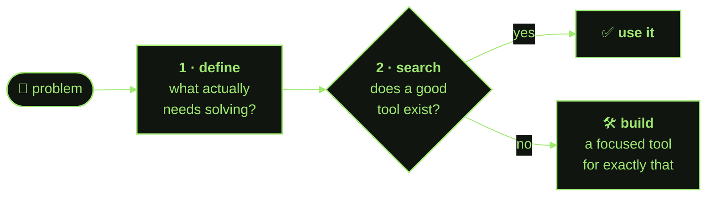

### Hey 👋

I like understanding how things work, finding the right tools for the job, and building small, practical things that make everyday life a bit better — mostly in Go, mostly on Linux.

  
  
  
  

**Main language:** Go · **Currently going deeper into:** automation, Docker and CI/CD.

---

### ▸ Things I've built

- [**typeTrainer**](https://github.com/nadludyna/typeTrainer) — a typing trainer that finds your weak letters and builds the next words around them. My engineering thesis. `Go` `JavaScript` `PostgreSQL` · [**▶ Try it**](https://nadludyna.github.io/typeTrainer/)

- [**ТЯГА**](https://github.com/nadludyna/tyaga) — paste a YouTube link, get a file. A small Go app with a browser UI, built on yt-dlp, with CI and releases for Windows, macOS and Linux. `Go` `yt-dlp` `GitHub Actions`

---

### ▸ Around the computer

- **Linux:** I've tried a lot of distros — mainstream and niche, hands-on and through articles and videos. What I care about is practical value: a clean, focused system without noise or bloat. My Linux home is CachyOS — Arch-based, polished, a great all-rounder — with KDE Plasma on top.
- **Windows:** Windows 11 is my main system right now. Clean installs from official ISOs, sensible software management, driver cleanup, WSL, Docker and PowerShell.
- **The pendulum:** Windows annoys me → I move to CachyOS for a while → Linux wears me out → back to Windows. Repeat. Both setups stay ready, so switching is cheap.
- **Self-hosting:** one project so far — a modded Minecraft server on Fabric, with scripts that check for mod updates.
- **Tinkering:** userscripts, Android app tweaks for my family, minimal modpacks, and getting old games to run on modern PCs.
- **Open source:** my default — but I'm happy to pay for software that earns it.

---

### ▸ How I approach problems

  <code>practical &gt; complex</code> · <code>useful &gt; impressive</code> · <code>docs = part of the work</code>

---

### ▸ Working with AI

  
  
  

I've been using LLMs since GPT-3. Today, Claude is my main coding agent — and just as much a thinking partner.

`raw thoughts` → `Obsidian vault` → `plan` → `Claude` → `PR`

**Thinking:** random ideas, half-formed plans and long streams of thought get sorted into something coherent. Whatever's worth keeping goes into Obsidian.

**Building:** I connect my vault, so Claude works from my own notes and drafts instead of a blank prompt. Then it's collaborative engineering: project rules, focused branches, pull requests, tests, and performance checks before merging.

**Other models:** I've tried most mainstream and Chinese ones (GLM 5.3 was a pleasant surprise), but Claude stays the strongest all-rounder for me. Gemini covers side chats and images; other models handle second opinions and code audits.

---

### ▸ Beyond tech

**🎮 Gaming** — I play a lot of different things, but I keep coming back to the same few: 
`atmospheric worlds` `RPGs` `immersive sims` `horror` `weird indie` — plus a soft spot for puzzles and the occasional cozy game.

**⌨️ Typing** — regular practice on Monkeytype, tracking speed and accuracy. Mechanical keyboard nerd. 
Current setup: <kbd>MonsGeek FUN60 Ultra</kbd> + <kbd>Astrolink switches</kbd>

**🧭 Perspective** — My brain often takes a non-standard route. That's where a lot of my ideas come from — and also some of the friction. I've learned to work with it instead of fighting it: no romanticizing the hard parts, no making them my whole identity. Adapt, stay curious, leave room for joy. *Amor fati.*

**🎧 Music** — a tuning knob for my nervous system: sometimes to balance a mood, sometimes to lean into it. 
Mostly atmosphere: `ethereal ambient` `dark ambient` `plunderphonics` `hauntology` `vaporwave` `barber beats` `muzak` `IDM` `glitch` `experimental` `game soundtracks` `liminal-space scores` 
Then: `alternative rock` `art rock` `progressive rock` `avant-prog` `progressive metal` `avant-garde metal` `lo-fi experimental indie` 
And the exact opposite: `breakcore` `jungle` `digital hardcore` `rage rap` `trap` `hyperpop`

**📚 Also into** — philosophy (Nietzsche, Hegel, Wittgenstein), questions of consciousness and AI, and an ever-growing collection of useful tools, guides and channels.

**🗣️ Languages** — Ukrainian · Russian · Polish · English · German *(basic)*

---

📍 Lublin, Poland · Open to remote work and freelance

  
  
  
  

> *One must still have chaos in oneself to give birth to a dancing star.* — Nietzsche
